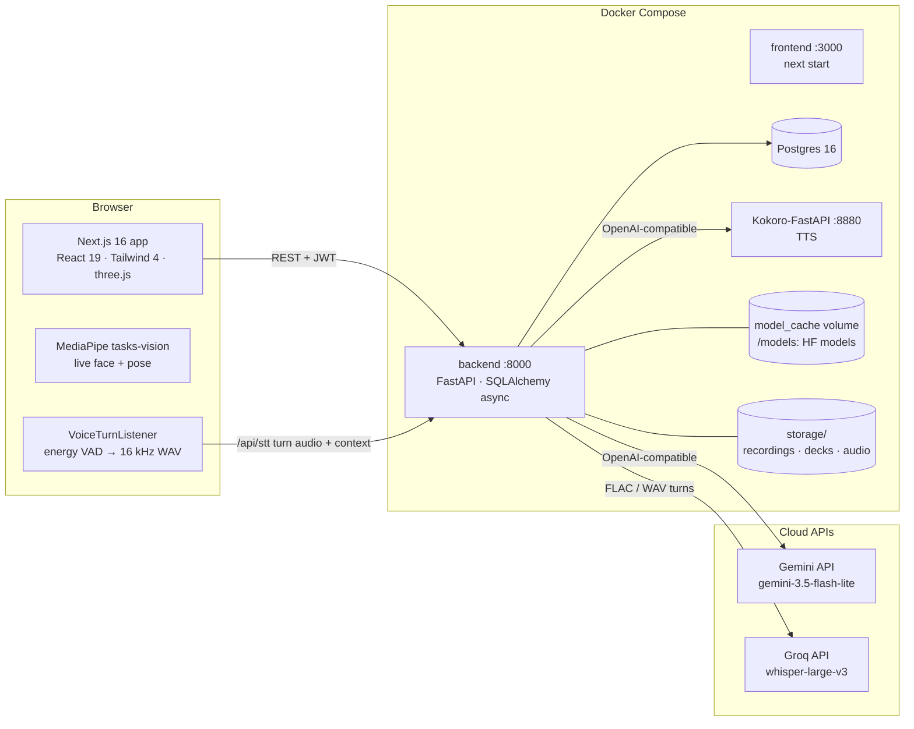

# Architecture

## System overview



Cloud configuration (deployed): speech-to-text goes to Groq `whisper-large-v3` and LLM calls to Gemini, both through OpenAI-compatible APIs; voice (Kokoro), pronunciation, prosody and vision run locally. A local LLM (Ollama) works by changing `LLM_BASE_URL`.

## Frontend (`frontend/`)

| Area | Path | Notes |
|---|---|---|
| Routes | `app/(auth)` login, register, onboarding · `app/(app)` home, conversation, interview, presentations, session, results/[id], progress, methodology, profile, settings | `(app)/layout.tsx` = nav + footer; `(app)/template.tsx` = page transition |
| Live session | `app/(app)/session/page.tsx` | camera stage, MediaPipe tracking, turn-taking, TTS playback, recording (MediaRecorder) |
| Live session pieces | `session/script.ts` (fallback prompts, topics, mood and pace helpers), `session/widgets.tsx` (message bubble, mic pulse, voice glow, volume meter, live transcript, partner character) | pure helpers and display components used by the page |
| Navigation | `components/layout/TopNav.tsx` (top: where you practise: Home, Conversation, Interview, Presentation, Progress, bell, profile chip), `components/layout/SideRail.tsx` (left, desktop: light/dark, Profile, Settings, Your data, How it's measured, Sign out) | on small screens both are in the top bar's menu |
| Companion and action animations | `components/layout/Mascot.tsx` + `lib/mascot.ts` (Mate reacts to `mascot(action)` calls: upload, delete, search, task ticked, error, results ready); `components/ui/UploadCard.tsx` (real upload progress via XHR, `api.upload(path, form, onProgress)`), `components/ui/DeleteButton.tsx` + `hooks/useExit.ts` (rows fold away), `components/ui/SearchBar.tsx` (decks, sessions); animations in `globals.css` (off under reduced motion) | |
| Learner profile | backend `services/learner.py`: one brief from study level, field, speaking level, goal, challenges and feedback style, added to the partner, interview / Q&A plan, answer, conversation and talk-feedback prompts; edited on `/profile` (with a "How your coach uses this" preview) | |
| Privacy & security | `app/(app)/privacy/page.tsx` (what's collected, where it goes, retention, protection, PDPA rights) + `components/privacy/PrivacyControls.tsx` (consent, keep recordings, export, delete account); the consent dialog links to it and stays closed there | |
| Tasks and pipeline | `components/home/TaskList.tsx` (Home: drills, decks to present or rehearse, retries, daily reminder; "In progress" tab; ticks in localStorage per account), `lib/deckPipeline.ts` (Preparing → Ready → Presented → Q&A rehearsed; the Presentations board) | |
| Turn capture | `lib/voiceTurns.ts` | adaptive energy VAD, 1.6 s end-of-turn silence, browser-filtered resample, `isBusy` |
| API client | `services/*.ts` (`api.ts` adds JWT, refreshes on 401) | |
| State | `store/` (zustand, persisted user) | |
| UI kit / 3D | `components/ui/kit.tsx`, `components/three/*`, `components/auth/VoiceOrb.tsx` | see Design_system.md |

## Backend (`backend/app/`)

| Router | Endpoints | Purpose |
|---|---|---|
| `auth.py` | `/auth/register · login · refresh · logout`, `/users/profile`, `/users/me/consent · export`, `DELETE /users/me` | bcrypt + JWT access/refresh, PDPA consent / access / erasure |
| `live.py` | `/live` (list = summaries, `?deck_id=`), `/live/{id}` + `/end · recording · analyze`, `/interview/plan · resume` | live sessions and their analysis |
| `conversation.py` | `/chat/message`, `/stt`, `/tts/speak` | AI partner turns, speech in/out (signed in; the cloud ones need consent) |
| `sessions.py` | `/sessions` (decks), `/sessions/{id}/retry`, `/sessions/{id}/slides/{n}/image` | presentation decks, owner only (slide images are fetched with the token: `SlideImage`) |
| `notifications.py` | `/notifications` | bell |
| `health.py` | `/health` | binaries, local ML, LLM, TTS availability |

Background work runs in-process (`services/tasks.py` `spawn`), so **restarting the backend interrupts running analyses** (they're marked failed and can be retried).

## Key flows

### Live session
1. Interview/Q&A: setup page builds or loads a **question plan** (interview: LLM from role/resume; Q&A: cached on the deck). `POST /live` creates the session.
2. Session page: AI opening line → user turn. `VoiceTurnListener` cuts each spoken turn, `POST /stt` (with context) → text → after 1.2 s (or "I'm done") `POST /chat/message` → reply → `POST /tts/speak` → playback → next turn.
3. End: `POST /live/{id}/end` (turns, client metrics) → upload recording → `POST /live/{id}/analyze` → results page polls `GET /live/{id}`.

### Analysis pipeline (`services/live/pipeline.py`)
```
recording → 16 kHz WAV ─┬─ content feedback (LLM, started immediately, in parallel)
                        ├─ speech: ASR (Groq, FLAC, silence filter) → fluency/fillers/stutter → pronunciation (+ prosody in parallel)
                        └─ then vision: frames → eye contact ‖ (posture → gestures) ‖ emotion
                              → Gaze Tunneling (2 fps gaze stream vs disfluency word timings, permutation test)
→ confidence (11 cues) → communication score → pillars → coaching plan (LLM) → usage (STT seconds, LLM tokens)
→ progress records + notification
```
Speech and vision run one after the other on purpose: running both model sets at once exhausted 7.6 GB of RAM.

### Deck pipeline (`services/pipeline.py`)
render slides → **insights** (LLM: summary, key point per slide) → **Q&A plan** (LLM, cached in insights). About a minute. (Example scripts, narration and video were removed on 2026-10-07.)

### Presenting a deck (live "talk" session)
`POST /live {session_type: "Presentation", deck_id, presentation_mode: "talk"}` stores each slide's title, text and key point in `context.slides`. The session page shows the slides (user-controlled: ←/→, Page Up/Down, buttons) with the camera; the AI stays silent. The browser records when each slide went up (`client_metrics.slide_times`). The analysis splits the transcript's word timings at those moments and judges each slide (`services/live/talk.py`: key-word coverage, then an LLM 1–5 match with covered / missing / tip).

## Deployment

`docker compose --profile tts up -d --build` from the repo root. Code is **copied into the images** (no bind mounts): rebuild to deploy. Models live in the `model_cache` volume (`/models`). See agents.md for the workflow.

## Known constraints

- CPU-only inference: LLM replies 2–15 s; analysis ~1–2 min for a few minutes of talk with enough RAM.
- WSL memory defaults to half of Windows RAM; raise it (`.wslconfig`) or analyses get OOM-killed.
