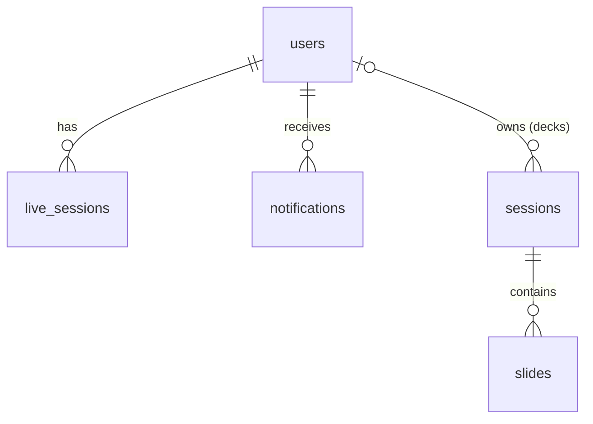

# Database

PostgreSQL 16 (Docker service `db`, database `speechmate_db`), accessed with async SQLAlchemy 2. Models: `backend/app/models/`; migrations: Alembic (`backend/alembic/`). Tests use SQLite (aiosqlite). JSON columns use `JSONType` (JSONB on Postgres).

## Entity relationships

All foreign keys cascade on delete, except `sessions.user_id` (SET NULL).

## Tables

### `users`
| Column | Type | Notes |
|---|---|---|
| id | uuid PK | |
| full_name | varchar(255) | |
| email | varchar(255) | unique, indexed |
| password_hash | text | bcrypt |
| role | varchar(50) | default `user` |
| language | varchar(50) | default `en`; unused (no longer set or shown) |
| age_group, communication_goal | varchar | optional |
| skill_level | varchar(50) | default `Beginner` |
| challenges | json | list of strings |
| study_level | varchar(50) | `Secondary` · `Pre-university` · `Undergraduate` · `Postgraduate` · `Working professional` (0009) |
| field_of_study | varchar(100) | free text (0009) |
| feedback_style | varchar(20) | `encouraging` · `balanced` · `direct` (0009) |
| created_at | timestamptz | |

### `live_sessions` (Conversation / Interview / Presentation Q&A)
| Column | Type | Notes |
|---|---|---|
| id | uuid PK | |
| user_id | uuid FK → users | indexed |
| session_type | varchar(50) | `Conversation` · `Interview` · `Presentation` |
| status | varchar(50) | `active` → `analyzing` → `complete` / `failed` |
| duration_sec | int | |
| recording_storage_path | text | under `storage/live/<id>/` |
| context | json | topic; interview `setup`, `resume_text`, `plan`, `progress`; presentation: deck id/title/summary + `kind` (`talk` with `slides` [{index, title, text, key_point}], or `qa` with `plan`); `llm_usage` {calls, prompt_tokens, completion_tokens} of the AI partner's turns |
| turns | json | `[{role, text, t_sec}]` (text includes the user's "Fix" corrections) |
| client_metrics | json | `response_latency_sec` [s], `stt_audio_sec` [seconds of each turn sent to speech recognition]; talk: `slide_times` [{slide_index, t_sec}]. Older sessions may hold a browser `gaze_tunneling` value: ignored since 2026-10-15 |
| analysis | json | full result: transcript, speech, vision, `communication_score`, `pillars`, `recommendations`, `content_feedback`, `details` (incl. `confidence.cues`; `gaze_tunneling` {r, p, label, windows, events} or null; `usage` {stt: {turn_requests, turn_audio_sec, analysis_audio_sec, billed_sec, usd}, llm: {calls, prompt_tokens, completion_tokens, turns, analysis}}, both absent on sessions analysed before 2026-10-15) |
| warnings | json | what couldn't be measured |
| error_detail | text | |
| created_at | timestamptz | |

### `notifications`
`user_id`, `kind` (`live_analysis`, `live_failed`, …), `title`, `body`, `link` (app route), `read_at`, `created_at`.

### `sessions` (presentation decks)
`user_id` (null only for decks from before accounts), `original_filename`, `pptx_storage_path`, `requirement_prompt`, `status` (`queued` → `processing_slides` → `analyzing_content` → `complete` / `failed`), `slide_count`, `insights` (json; includes the cached `qa_plan`), `warnings`, `error_detail`, `created_at`, `updated_at`.

### `slides`
`session_id`, `slide_index` (unique per deck), `png_storage_path`, `slide_text`.

### Removed (migration 0008, 2026-10-20)
Left over from removed features: the example narration's columns on `sessions` / `slides`, the old upload-a-rehearsal coach (`practice_sessions`, `chat_messages`), and `progress_records` / `reports` (a copy of scores already in `live_sessions.analysis`). `alembic downgrade 0007` brings them back empty.

## Files (not in the database)

`backend/storage/` (Docker volume): deck files, rendered slides and live recordings (deleted after analysis unless the user keeps recordings). Deleting a session deletes its folder.

## Conventions

- UUID primary keys everywhere; timestamps are timezone-aware UTC.
- Mutating a JSON column: assign a **new** dict (`row.insights = {**row.insights, "k": v}`) so SQLAlchemy saves it.
- Analysis output is versioned by shape, not by column: readers must tolerate missing keys from older sessions (e.g. `answer` in answer feedback, `confidence.cues`).
